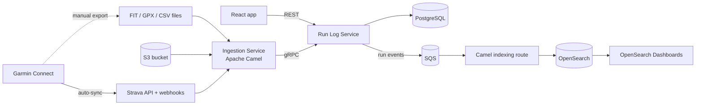

# Run Log – Learning Project Plan

A personal training log for planning weekly mileage and comparing it with what actually happened. It replaces the current spreadsheet and is used as a vehicle for learning new technologies.

## Goals

- **Product goal:** Plan runs per week (morning and afternoon slots), record actual runs manually or import them from Strava and Garmin, and compare plan with reality.
- **Learning goal:** Gain hands-on confidence with Kotlin, Spring Boot, React, gRPC, Apache Camel, Docker, OpenSearch and AWS.

Each phase ends with something that works, so the system is never half-broken.

## Technology map

| Technology | Role in the project |
|---|---|
| Kotlin + Spring Boot | Run Log Service (core backend) and Ingestion Service |
| PostgreSQL | Main data store for plans and activities |
| React (Vite + TypeScript) | Week grid and period views, editing plans and actuals |
| gRPC | Internal API between Ingestion Service and Run Log Service |
| Apache Camel | Importing runs from files (FIT/GPX/CSV), S3, Strava and SQS |
| Docker / Docker Compose | Local environment for all services and infrastructure |
| OpenSearch | Search, aggregations and dashboards on training data |
| AWS | S3, SQS, ECR, ECS Fargate, RDS, optionally OpenSearch Service |

## Architecture



## Domain model

The plan and the actual runs are stored separately. The comparison is computed, never stored.

### Entities

- **TrainingPeriod** – name (e.g. "Base period"), start date, end date.
- **PlannedSession** – date, slot (`MORNING` / `AFTERNOON`), description, planned km.
- **Activity** – an actual run: start time, distance, duration, optional pace and heart rate, source (`MANUAL` / `STRAVA` / `GARMIN_FILE`), external ID (unique per source, prevents duplicate imports), optional slot override.
- **WeekNote** – ISO year, ISO week, comment.

### Rules

- An activity is matched to a slot by date and start time: before 12:00 is morning, from 12:00 afternoon.
- A slot override on an activity wins over the time-based rule.
- Weekend days can have a single slot (or simply only use `MORNING`).
- Weekly and period totals are sums over planned sessions and matched activities.
- Weeks use ISO week numbering (Monday to Sunday).

### Sample data (from the current spreadsheet)

**Week 46 (9–15 November), Base period**

| Day | Morning plan | Afternoon plan |
|---|---|---|
| Mon | 0 km – cycling | 6.8 km – warm-up, strength, run home |
| Tue | 9 km easy | 11 km – 7×4 min |
| Wed | 4.5 km recovery | 6.8 km – warm-up, strength, run home |
| Thu | 9 km easy | 4.5 km recovery |
| Fri | 9 km easy | 0 km – cycling |
| Sat | 14 km | – |
| Sun | 30 km | – |

Planned total: 104.6 km. Week 47 is the same except Friday afternoon is 4.5 km, giving 109.1 km.

## REST API (for the React app)

| Method | Path | Purpose |
|---|---|---|
| `GET` | `/api/weeks/{year}/{week}` | Whole week in one call: planned sessions, matched activities, slot and week totals, week note |
| `GET` | `/api/periods/{id}/summary` | Planned vs actual totals per week for a period |
| `POST` | `/api/planned-sessions` | Create a planned session |
| `PUT` | `/api/planned-sessions/{id}` | Edit a planned session |
| `DELETE` | `/api/planned-sessions/{id}` | Delete a planned session |
| `POST` | `/api/activities` | Add an actual run manually |
| `PUT` | `/api/activities/{id}` | Edit an actual run (incl. slot override) |
| `DELETE` | `/api/activities/{id}` | Delete an actual run |
| `PUT` | `/api/weeks/{year}/{week}/note` | Set the week comment |
| `POST` | `/api/weeks/{year}/{week}/copy-from/{sourceYear}/{sourceWeek}` | Copy the plan of another week |
| `CRUD` | `/api/periods` | Manage training periods |

## gRPC API (internal)

Shared `proto` module, Kotlin stubs generated with grpc-kotlin (coroutine-based).

```proto
service RunService {
  rpc CreateActivity(CreateActivityRequest) returns (Activity);
  rpc GetActivity(GetActivityRequest) returns (Activity);
  rpc ListActivities(ListActivitiesRequest) returns (stream Activity);
}
```

`CreateActivity` must be idempotent on `(source, external_id)`, so re-imports are safe.

## React frontend

- **Stack:** Vite, TypeScript, TanStack Query for API calls and caching.
- **Week grid:** Mirrors the spreadsheet. Days as columns; planned and actual rows per slot; week total column. Planned cells editable inline. Actual cells coloured by deviation from plan (green / amber / red).
- **Week navigation:** Previous / next week, jump to date, "copy plan from previous week".
- **Activity editing:** Add or edit a manual run, change slot assignment.
- **Period view:** Bar chart of planned vs actual km per week, with the period total.

## Ingestion strategy

1. **Manual entry** through the React app (phase 1).
2. **Files:** FIT, GPX and CSV files dropped into a watched folder, later an S3 bucket. Covers Garmin via manual export from Garmin Connect.
3. **Strava:** OAuth for your own account, webhook subscription for new activities, Camel route fetches and maps the activity.
4. **Garmin:** The Garmin Connect developer program targets companies, so don't rely on direct access. Instead, enable Garmin → Strava auto-sync so Strava covers Garmin runs, and keep file import as a backup.

Before building the Strava integration, check Strava's current API terms and rate limits.

## Repository structure

Gradle multi-module monorepo:

```
run-log/
├── proto/                 # .proto files and generated stubs
├── run-log-service/       # Spring Boot: REST, gRPC server, JPA
├── ingestion-service/     # Spring Boot + Camel routes
├── frontend/              # React (Vite + TypeScript)
├── infra/                 # CDK (Kotlin) or Terraform, later
└── docker-compose.yml
```

## Phases

### Phase 1 – Core app, React UI and Docker

**Build**
- Domain model, JPA entities, Flyway migrations, PostgreSQL.
- REST API from the table above, including slot matching and totals.
- React week grid with inline editing and manual activity entry.
- Dockerfiles (multi-stage, or `bootBuildImage` for the backend), Docker Compose with backend, frontend and Postgres.

**Done when:** The spreadsheet can be replaced. Weeks 46 and 47 can be entered and compared.

**Learn:** Spring Boot structure, Kotlin with JPA, React data fetching, containers, Compose networking, volumes, env-based config.

### Phase 2 – gRPC

**Build**
- `proto` module with `RunService`.
- gRPC server in the Run Log Service next to REST.
- Small Kotlin CLI client; test also with `grpcurl`.
- Try server streaming with `ListActivities`.

**Done when:** Activities can be created and listed over gRPC.

**Learn:** Protobuf, code generation, coroutine stubs, streaming, error status codes.

### Phase 3 – Apache Camel ingestion

**Build**
- Ingestion Service with the Camel Spring Boot starter.
- Route 1: watched folder → CSV → split rows → map → gRPC `CreateActivity`.
- Route 2: GPX and FIT parsing, distance and duration calculation.
- Error handling: retries, dead-letter folder for bad files, logging.
- Route 3: Strava webhook → fetch activity → map → gRPC.

**Done when:** A Garmin export file and a new Strava run both show up in the week grid automatically.

**Learn:** Enterprise integration patterns (splitter, content-based router, dead letter channel), Camel components, OAuth, webhooks, idempotency.

### Phase 4 – OpenSearch

**Build**
- OpenSearch and OpenSearch Dashboards in Docker Compose.
- Run Log Service publishes a "run created/updated" event; a Camel route indexes it.
- Index mapping (`text` vs `keyword`, dates, numbers, optional `geo_point` for route start).
- Search endpoint: full-text on descriptions and notes, filters by date and distance.
- Aggregations: km per week, pace trend, plan adherence per period.
- Dashboard in OpenSearch Dashboards.

**Done when:** Plan adherence and weekly trends can be explored in a dashboard.

**Learn:** Mappings, analyzers, query DSL, aggregations, keeping a search index in sync.

### Phase 5 – AWS services locally (LocalStack)

**Build**
- LocalStack in Docker Compose.
- Replace the watched folder with an S3 bucket (`aws2-s3` component).
- Replace internal events with an SQS queue (`aws2-sqs` component).
- Configure endpoints per Spring profile (`local`, `aws`).

**Done when:** Uploading a file to the local S3 bucket ends up in Postgres and OpenSearch through SQS.

**Learn:** S3 and SQS concepts, AWS SDK config, environment-specific configuration, without cost or risk.

### Phase 6 – Deploy to AWS

**Build**
- Budget alarm first.
- Push images to ECR, run services on ECS Fargate.
- RDS for PostgreSQL, real S3 and SQS.
- Infrastructure as code with AWS CDK (Kotlin) or Terraform.
- Frontend on S3 + CloudFront, or as a container.
- Amazon OpenSearch Service only briefly for learning (it's costly to leave running), otherwise keep OpenSearch local.

**Done when:** The app runs in AWS and can be torn down and recreated from code.

**Learn:** IAM, networking (VPC, security groups), container deployment, managed services, cost awareness.

## Cross-cutting practices

- **Testing:** Testcontainers from phase 1 for Postgres, later OpenSearch and LocalStack.
- **Migrations:** Flyway for all schema changes.
- **Config:** Spring profiles; no secrets in the repository.
- **Flashcards:** Turn each phase's learnings into Kotlin/Spring cards in Obsidian (`Sources/Anki/Kotlin_Spring/`).

## Stretch goals

- Observability with OpenTelemetry: traces across REST, gRPC and Camel routes.
- Authentication with Spring Security (e.g. OAuth login).
- CI with GitHub Actions: build, test, push images to ECR.
- Training load metrics (e.g. acute vs chronic load) computed from activities.
- Mobile-friendly layout for entering runs on the phone.
